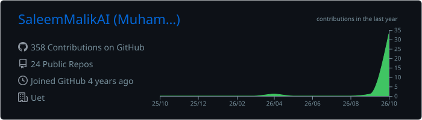
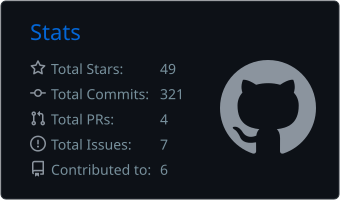
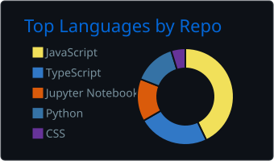

<!-- Profile README for github.com/SaleemMalikAI -->
<!-- The stats cards and the snake fill in after the two workflows in .github/workflows run for the first time. -->

<p align="center">
  
</p>

<p align="center">
  <a href="https://saleem-malik.vercel.app">
    <picture>
      <source media="(prefers-color-scheme: dark)" srcset="https://readme-typing-svg.demolab.com?font=Fira+Code&weight=600&size=22&duration=3000&pause=900&color=A3E635&center=true&vCenter=true&width=680&height=50&lines=Building+AI-powered+web+products;Next.js+%C2%B7+TypeScript+%C2%B7+FastAPI+%C2%B7+Python;LLMs%2C+RAG+and+AI+agents+in+real+products;Open+to+AI+Full+Stack+roles+%E2%80%94+Lahore+or+remote" />
      
    </picture>
  </a>
</p>

<p align="center">
  <a href="https://saleem-malik.vercel.app"></a>
  <a href="https://www.linkedin.com/in/devsaleemalik"></a>
  <a href="mailto:saleemalik444@gmail.com"></a>
  
</p>

> [!TIP]
> **Open to work:** AI Full Stack Engineer roles, onsite or hybrid in Lahore, or remote. Reach me at [saleemalik444@gmail.com](mailto:saleemalik444@gmail.com).

## 👨‍💻 About me

```ts
const saleem = {
  role: "AI Full Stack Engineer",
  location: "Lahore, Pakistan 🇵🇰",
  experience: "2 years shipping production web apps and AI APIs",
  education: "BS Computer Science, UET Lahore (2025)",
  frontend: ["React", "Next.js", "TypeScript", "Tailwind CSS"],
  backend: ["FastAPI", "Python", "Node.js", "PostgreSQL"],
  ai: ["LLMs", "RAG", "LangChain", "AI agents", "Speech AI"],
  building: "Mock Interview Coach, a voice-first AI interviewer",
  openTo: "AI Full Stack roles · Lahore (onsite/hybrid) or remote",
};
```

- 🧩 **Frontend end to end:** built and maintained a production Next.js/TypeScript product across multiple repos (website, developer tools, API docs), with a shared component package published to a private npm registry.
- ⚙️ **AI APIs in production:** Speech-to-Text, Text-to-Speech and Voice Cloning APIs built with FastAPI and async Python.
- 🧠 **LLMs that stay grounded:** RAG pipelines, structured outputs and validation, so AI features answer from real data instead of guessing.
- ⚡ **Performance and reliability:** Core Web Vitals (LCP, CLS, INP), auth flows, and data-quality pipelines on PostgreSQL.

## 💼 Experience

| Role | Company | When |
| :--- | :--- | :--- |
| **AI Full Stack Engineer** | JFreaks Software Solutions (APIFreaks) | 2025 – 2026 |
| **AI Engineer Intern** | PureLogics | Jun – Sep 2024 |
| **Professional Freelancer** | Fiverr | 2022 – 2024 |

## 🚀 Featured projects

<table>
<tr>
<td width="50%" valign="top">

### 🎫 [AI Ticket System](https://github.com/SaleemMalikAI/AI-ticket-system)

Support ticket management with AI triage: every new ticket gets a summary plus a suggested category and priority. An **Ask AI** assistant answers questions about the queue in plain English using validated query plans instead of text-to-SQL, and every reply is checked against the database.

`Next.js` `FastAPI` `PostgreSQL` `Groq` `Docker`

</td>
<td width="50%" valign="top">

### 🎙️ [Mock Interview Coach](https://github.com/SaleemMalikAI/Mock-Interview-Coach)

Voice-first AI mock interviewer. Pick a role or paste a job description, answer out loud, and get a Whisper transcript in seconds. Questions are picked with RAG over a pgvector question bank, with a progress dashboard and streaks. 🚧 *In progress*

`Next.js` `FastAPI` `Supabase` `pgvector` `Groq`

[**Live demo →**](https://mock-interview-coach-rust.vercel.app)

</td>
</tr>
<tr>
<td width="50%" valign="top">

### 🔎 [RAG & AI Agents with LangChain](https://github.com/SaleemMalikAI/RAG-Using-LangChain)

RAG built up step by step: basic RAG, advanced retrieval, an agent that combines PDF retrieval with Tavily web search, and multimodal RAG, plus tool-using agents such as an email-sending agent.

`LangChain` `Pinecone` `OpenAI` `Groq` `Tavily`

</td>
<td width="50%" valign="top">

### 🕵️ [Deepfake Detection](https://github.com/SaleemMalikAI/Deepfake-Detection-system-using-CNN)

Transfer-learning deepfake detector: a pretrained ResNeXt CNN extracts features and an LSTM classifies images as real or fake.

`Python` `Deep Learning` `ResNeXt` `LSTM`

</td>
</tr>
</table>

<p align="center">
  <a href="https://github.com/SaleemMalikAI?tab=repositories"></a>
</p>

## 🛠️ Tech stack

| | |
| :--- | :--- |
| **Frontend** |  |
| **Backend & data** |  |
| **Tools & DevOps** |  |

<p align="center"><b>AI / ML</b></p>

<p align="center">
  
  
  
  
  
  
  
  
  
  
  
  
</p>

## 🔨 Right now

- Building **Mock Interview Coach**: AI answer scoring and speech metrics are next.
- Going deeper on system design and production LLM patterns (streaming, evals, guardrails).
- Looking for a team that ships AI-powered products.

## 📊 GitHub activity

<p align="center">
  
</p>

<p align="center">
  
  
</p>

<p align="center">
  
</p>

<p align="center">
  <picture>
    <source media="(prefers-color-scheme: dark)" srcset="https://raw.githubusercontent.com/SaleemMalikAI/SaleemMalikAI/output/github-snake-dark.svg" />
    <source media="(prefers-color-scheme: light)" srcset="https://raw.githubusercontent.com/SaleemMalikAI/SaleemMalikAI/output/github-snake.svg" />
    
  </picture>
</p>

<p align="center">
  <i>Thanks for stopping by. If you're building something with AI, let's talk.</i>
</p>

<p align="center">
  
</p>
